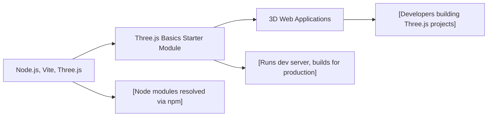

# Three.js Basics Starter Module

## Overview
The Three.js Basics Starter module provides a pre-configured development environment for creating 3D web experiences using Three.js. It streamlines project setup by integrating key development tools and dependencies, allowing developers to focus on building interactive 3D scenes rather than configuring the build process.

## Key Features
- **Three.js Integration**: Offers direct access to Three.js, a leading JavaScript 3D library, for building advanced web-based 3D graphics.
- **Development Server**: Includes a local server via Vite that enables rapid development with live-reloading at `localhost:8080`.
- **Production Build Pipeline**: Supports bundling and optimizing assets for production using Vite’s build capabilities.
- **Out-of-the-Box Project Structure**: Supplies a ready-to-use project directory and recommended package dependencies.

## System Errors
- **Module Not Found**: Occurs if `three` or `vite` are missing.  
  *Resolution*: Run `npm install` to ensure all dependencies are available.
- **Port In Use**: If port 8080 is already in use, the dev server may fail to start.  
  *Resolution*: Stop the conflicting service or configure Vite to use a different port.
- **Build Failures**: Errors during `npm run build` often stem from missing files or misconfigured imports.  
  *Resolution*: Check error logs for missing assets or incorrect file references.

## Usage Examples

```bash
# Install all Node.js dependencies
npm install

# Start the development server with hot reloading
npm run dev
# Access the app at http://localhost:8080

# Build the project for production deployment
npm run build
# The output is placed in the 'dist' directory
```

## System Integration


