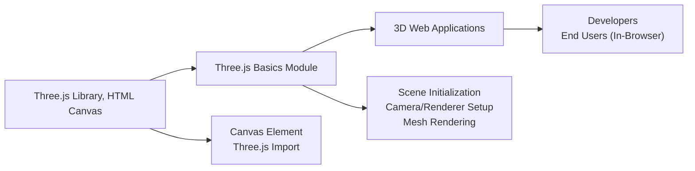

# Three.js Basics API Overview

## Overview
This module serves as an entry-level integration of Three.js for rendering 3D graphics in the browser. It provides the foundational setup to display 3D objects within a web canvas, enabling interactive and visually rich scenes. This module is intended as a starting template for web-based 3D visualization.

## Key Features
- **Canvas-Based 3D Rendering**: Renders 3D graphics to an HTML `<canvas>` element, supporting modern interactive web experiences.
- **Scene Initialization**: Quickly sets up a Three.js scene with default geometry, camera, and renderer—streamlining the process for new projects or experiments.
- **Camera Management**: Integrates a configurable perspective camera, allowing users to control the viewpoint of their 3D scene.
- **Basic Mesh Support**: Demonstrates object creation with geometry and material, showcasing how to add and display 3D objects.

## System Errors
- **Missing Canvas Element**: If the `<canvas class="webgl">` element is not present in the HTML, rendering will fail.  
  _Resolution_: Ensure the canvas element exists in your HTML mark-up and uses the correct selector.
- **WebGL Context Not Available**: If the browser or device does not support WebGL, Three.js rendering will fail to initialize.  
  _Resolution_: Use a modern browser with WebGL support; check hardware compatibility.

## Usage Examples

```js
// Import Three.js (install via npm or use CDN as needed)
import * as THREE from 'three'

// Select the canvas where the scene will be drawn
const canvas = document.querySelector('canvas.webgl')

// Create a new scene
const scene = new THREE.Scene()

// Define a 3D box geometry and a basic red material
const geometry = new THREE.BoxGeometry(1, 1, 1)
const material = new THREE.MeshBasicMaterial({ color: 0xff0000 })
const mesh = new THREE.Mesh(geometry, material)
scene.add(mesh) // Add mesh to the scene

// Set up camera with perspective projection
const sizes = { width: 800, height: 600 }
const camera = new THREE.PerspectiveCamera(75, sizes.width / sizes.height)
camera.position.z = 3
scene.add(camera)

// Create renderer and link it to the canvas
const renderer = new THREE.WebGLRenderer({ canvas: canvas })
renderer.setSize(sizes.width, sizes.height)
renderer.render(scene, camera) // Draw the scene from the camera's viewpoint
```

## System Integration

