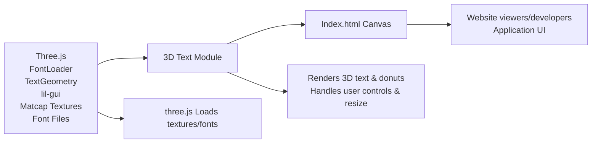

# 3D Text Module

## Overview
The 3D Text module enables rendering and interactive manipulation of custom 3D text in a web browser using Three.js. It loads fonts, generates 3D text geometry, applies advanced materials and effects, and displays the result in a fully interactive 3D scene. The module serves as a foundational feature for web applications requiring 3D text visualization, such as games, showcases, or UI components.

## Key Features
- **3D Text Rendering**: Generates and displays 3D text using a loaded font and advanced mesh geometry.
- **Custom Materials**: Applies matcap textures to the 3D text and decorative objects for visually appealing effects.
- **Interactive Camera Controls**: Allows users to orbit, pan, and zoom within the 3D scene using mouse or touch input.
- **Responsive Layout**: Adapts to browser window size changes for optimal view and usability.
- **Batch Mesh Generation**: Procedurally adds multiple decorative 3D objects (torus shapes) across the scene for visual complexity.
- **Font Loading**: Supports asynchronous loading of JSON-based font files to create custom text geometries.

## System Errors
- **Texture/Font Loading Error**: If the required texture (`/textures/matcaps/1.png`) or font (`/fonts/helvetiker_regular.typeface.json`) is missing or inaccessible, 3D text will not render.  
  **Resolution**: Ensure proper paths and file availability on the server or in the build output.
- **WebGL Not Supported**: If the browser doesn’t support WebGL, rendering will fail.  
  **Resolution**: Use an up-to-date browser with WebGL support; check for errors via browser console.
- **Resize Synchronization Issue**: On rare occasions, window resizing may cause aspect-ratio or rendering artifacts.  
  **Resolution**: Trigger a manual refresh or ensure proper event propagation in the application shell.

## Usage Examples

```js
// Import Three.js and required helpers (in vite or bundled environment)
import * as THREE from 'three'
import { OrbitControls } from 'three/examples/jsm/controls/OrbitControls.js'
import { FontLoader } from 'three/examples/jsm/loaders/FontLoader.js'
import { TextGeometry } from 'three/examples/jsm/geometries/TextGeometry.js'

const canvas = document.querySelector('canvas.webgl')
const scene = new THREE.Scene()
const textureLoader = new THREE.TextureLoader()
const matcapTexture = textureLoader.load('/textures/matcaps/1.png')

const fontLoader = new FontLoader()
fontLoader.load(
    '/fonts/helvetiker_regular.typeface.json',
    (font) => {
        const textGeometry = new TextGeometry(
            'Your 3D Text', 
            {
                font: font,
                size: 0.5,
                height: 0.2,
                bevelEnabled: true,
                bevelThickness: 0.03,
                bevelSize: 0.02,
                bevelSegments: 4
            }
        )
        textGeometry.center()
        const material = new THREE.MeshMatcapMaterial({ matcap: matcapTexture })
        const text = new THREE.Mesh(textGeometry, material)
        scene.add(text)
    }
)

// Camera, renderer, and controls (boilerplate omitted for brevity)
```

## System Integration


