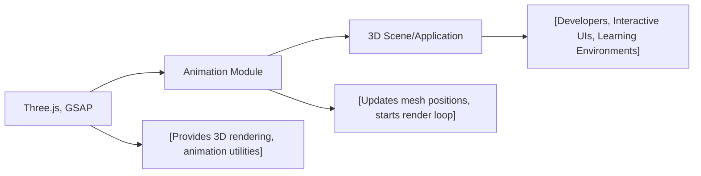

# Animation Module

## Overview
The Animation module enables 3D object animation in a Three.js-powered scene. It demonstrates how to animate mesh positions using both time-based frame updates and GSAP (GreenSock Animation Platform) tweening. The module is intended for learning and prototyping interactive 3D scenes that require basic object movement and animation, integrating seamlessly with other Three.js components such as cameras, renderers, and scenes.

## Key Features
- **3D Object Animation**: Provides real-time position updates of 3D objects (e.g., moving a cube in circular motion) using JavaScript timing functions.
- **GSAP Integration**: Optionally supports GSAP to create smooth, timeline-based animations alongside manual updates.
- **Three.js Integration**: Hooks directly into Three.js rendering systems, ensuring animation is tightly coupled to the render loop and scene graph.
- **Customizable Render Loop**: Offers a foundational pattern for updating animations in sync with rendering using `requestAnimationFrame`.
- **Basic Scene Setup**: Supplies boilerplate for initializing a scene, camera, renderer, and mesh, helping users quickly scaffold animation-driven 3D projects.

## System Errors
- **Canvas Not Found**: Occurs if a `<canvas class="webgl">` is missing from the HTML.  
  *Resolution*: Ensure the HTML includes `<canvas class="webgl"></canvas>` as shown in the usage example.

- **Three.js Import Failed**: If Three.js or GSAP is not installed/misconfigured.  
  *Resolution*: Run `npm install` to install dependencies, and verify correct import paths in your script files.

## Usage Examples
Practical code examples for adding animated 3D objects:

```js
import * as THREE from 'three'
import gsap from 'gsap'

// Select canvas and initialize Three.js scene
const canvas = document.querySelector('canvas.webgl')
const scene = new THREE.Scene()

// Add a cube mesh
const geometry = new THREE.BoxGeometry(1, 1, 1)
const material = new THREE.MeshBasicMaterial({ color: 0xff0000 })
const mesh = new THREE.Mesh(geometry, material)
scene.add(mesh)

// Set up camera and renderer
const sizes = { width: 800, height: 600 }
const camera = new THREE.PerspectiveCamera(75, sizes.width / sizes.height)
camera.position.z = 3
scene.add(camera)

const renderer = new THREE.WebGLRenderer({ canvas })
renderer.setSize(sizes.width, sizes.height)

// Animate with time-based updates
const clock = new THREE.Clock()
const tick = () => {
    const elapsedTime = clock.getElapsedTime()
    mesh.position.y = Math.sin(elapsedTime) // Up/down animation
    mesh.position.x = Math.cos(elapsedTime) // Side-to-side animation
    renderer.render(scene, camera)
    window.requestAnimationFrame(tick)
}
tick()

// Optional: Use GSAP for timeline-based animation
// gsap.to(mesh.position, { duration: 1, delay: 1, x: 2 })
```

## System Integration


