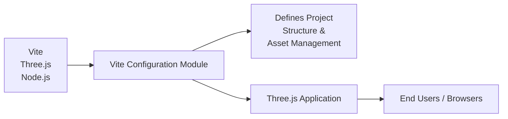

# Vite Configuration Module

## Overview
This module provides project configuration for Vite, a modern frontend build tool, tailored for use with Three.js-based applications. Its purpose is to define project structure, asset management, and local development behavior, ensuring the development and build process aligns with the project's architectural needs.

## Key Features

- **Custom Project Structure**: Sets `src/` as the source code root and uses a dedicated static assets directory (`static/`), separating code and static assets for maintainability.
- **Networked Development Server**: Configures the Vite dev server to be accessible over the local network and automatically opens the browser, improving the developer experience.
- **Controlled Build Output**: Stores build artifacts in a top-level `dist/` directory, ensures artifact freshness via clean builds, and generates source maps for debugging.
- **Local and Sandbox Compatibility**: Detects if running inside sandboxed environments (e.g., CodeSandbox) to toggle auto-opening behavior, supporting a seamless transition between local and cloud development.

## System Errors

- **Incorrect Root Directory**: If files are not found or served incorrectly, ensure the project is launched from the correct directory and `src/` contains the application entry point.
    - **Resolution**: Verify the `root` and `publicDir` settings match your folder layout.
- **Missing Static Assets**: Static files not appearing may be due to misplacement outside the `static/` folder.
    - **Resolution**: Place all static assets, such as images, in `static/` to serve them correctly.
- **Build Output Issues**: If build artifacts do not appear in the expected `dist/` location, confirm build scripts are executed from the project root.
    - **Resolution**: Use `npm run build` from the project’s root and ensure `outDir` is correctly referenced.

## Usage Examples

```js
// Start a local development server (auto-opens browser unless running in a sandbox)
npm run dev

// Build the project for production; output goes to /dist with a fresh state each time
npm run build

// Access project files:
// Source code: /src
// Static assets: /static
// Production build: /dist
```

## System Integration


