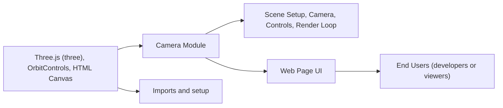

# Camera Module

## Overview
The Camera module provides a basic rendering setup using Three.js for 3D scenes with interactive camera controls. It demonstrates how to integrate and configure a Three.js camera, add objects to a scene, and enable user-controlled camera movement. This module is foundational for applications involving 3D graphics and user interaction via the camera view.

## Key Features
- **Three.js Scene Rendering**: Sets up a 3D scene that renders a sample object (a red cube) using the Three.js framework.
- **Perspective Camera Management**: Creates and configures a PerspectiveCamera with an appropriate aspect ratio, enabling depth perception in scenes.
- **Interactive Orbit Controls**: Integrates OrbitControls to allow users to interactively pan, zoom, and orbit the camera around objects via mouse input.
- **Responsive Rendering**: Configures the renderer and canvas size, ensuring the scene is visually coherent and fits the intended display area.
- **Animation Loop**: Implements a continuously running render loop for smooth animation and real-time updates as the camera or objects move.

## System Errors
- **Canvas Not Found**: If the `canvas.webgl` selector does not exist in the DOM, rendering will fail.
  - **Resolution**: Ensure the `<canvas class="webgl"></canvas>` element exists in your HTML.
- **Incorrect Canvas Size Calculation**: If `sizes.width` and `sizes.height` do not match the actual rendered area, the scene may appear stretched or distorted.
  - **Resolution**: Adjust the `sizes` object or update canvas size dynamically for responsive layouts.
- **Three.js Import Issues**: If `three` or `OrbitControls` are not installed or cannot be imported, module load will fail.
  - **Resolution**: Run `npm install` and ensure dependencies are correct (`three` package is installed).

## Usage Examples

```js
// Import Three.js and OrbitControls
import * as THREE from 'three'
import { OrbitControls } from 'three/addons/controls/OrbitControls.js'

// Query the canvas element
const canvas = document.querySelector('canvas.webgl')

// Set the rendering size
const sizes = { width: 800, height: 600 }

// Set up the scene
const scene = new THREE.Scene()

// Add a red cube to the scene
const mesh = new THREE.Mesh(
    new THREE.BoxGeometry(1, 1, 1, 5, 5, 5),
    new THREE.MeshBasicMaterial({ color: 0xff0000 })
)
scene.add(mesh)

// Create and position the camera
const camera = new THREE.PerspectiveCamera(75, sizes.width / sizes.height)
camera.position.z = 2
scene.add(camera)

// Add orbit controls for camera interaction
const controls = new OrbitControls(camera, canvas)
controls.enableDamping = true

// Set up the renderer
const renderer = new THREE.WebGLRenderer({ canvas: canvas })
renderer.setSize(sizes.width, sizes.height)

// Animation loop
function animate() {
    controls.update()
    renderer.render(scene, camera)
    requestAnimationFrame(animate)
}
animate()
```

## System Integration


