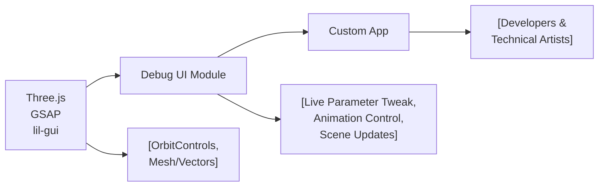

# Debug UI Module

## Overview
The Debug UI module provides an interactive user interface for live debugging and parameter tweaking of Three.js 3D scenes. It enables developers and technical artists to adjust scene object properties, material settings, and trigger handy actions directly in the browser, significantly speeding up the iteration process during development. The module uses [lil-gui](https://lil-gui.georgealways.com/) for the UI, integrates with Three.js for rendering, and uses GSAP for animation control.

## Key Features
- **Live Parameter Tweaking**: Allows real-time adjustment of object properties (e.g., position, visibility, material color, wireframe mode) via an interactive GUI.
- **Action Triggers**: Expose convenient “button” actions, such as spinning the object through GSAP-powered animations.
- **Dynamic Geometry Editing**: Enables interactive modification of the mesh subdivision, instantly reconstructing geometry as parameters change.
- **Visibility & Wireframe Controls**: Toggle visibility and wireframe states of mesh materials without code changes.
- **Keyboard Show/Hide**: Quickly show or hide the debug UI by pressing 'h', keeping the interface clutter-free.
- **Folder Organization**: Group tweakable controls into folders for better structure, enhancing usability in complex scenes.

## System Errors
- **GUI Not Visible / Hidden Unexpectedly**:  
  **Description:** The debug UI may not appear if it's hidden by default.  
  **Resolution:** Press the `h` key to toggle the UI. Ensure no browser key event blockers interfere.

- **Incorrect Mesh Update after Geometry Change**:  
  **Description:** Changing subdivision may result in geometry not updating or rendering artifacts.  
  **Resolution:** This can occur if the mesh geometry is not properly disposed of before creating new geometry. The module disposes old geometry as part of the update process, so ensure you do not have stale references elsewhere.

- **Parameter Changes Not Reflected**:  
  **Description:** Modifying a parameter (e.g., color) in the UI does not update the object.  
  **Resolution:** The corresponding event callback (e.g., onChange) must correctly update the mesh or material. The module wires these up for exposed parameters like color and geometry.

## Usage Examples

```js
// Import as ES Modules in your project entrypoint
import * as THREE from 'three'
import { OrbitControls } from 'three/examples/jsm/controls/OrbitControls.js'
import gsap from 'gsap'
import GUI from 'lil-gui'

// Initialize Debug UI
const gui = new GUI({ width: 300, title: 'Nice debug UI' })
const debugObject = { color: '#3a6ea6' }

// Create your Three.js mesh/material and add them to the scene
const geometry = new THREE.BoxGeometry(1, 1, 1, 2, 2, 2)
const material = new THREE.MeshBasicMaterial({ color: debugObject.color })
const mesh = new THREE.Mesh(geometry, material)
scene.add(mesh)

// Add tweakable parameters to the UI
const cubeTweaks = gui.addFolder('Awesome cube')
cubeTweaks.add(mesh.position, 'y').min(-3).max(3).step(0.01).name('elevation ')
cubeTweaks.add(mesh, 'visible')
cubeTweaks.add(material, 'wireframe')
cubeTweaks.addColor(debugObject, 'color').onChange(() => {
  material.color.set(debugObject.color)
})

// Add custom actions
debugObject.spin = () => {
  gsap.to(mesh.rotation, {duration: 1, y: mesh.rotation.y + Math.PI * 2})
}
cubeTweaks.add(debugObject, 'spin')

// Show/hide UI with keyboard
window.addEventListener('keydown', (event) => {
  if(event.key == 'h') gui.show(gui._hidden)
})

// Dynamic geometry update
debugObject.subdivision = 2
cubeTweaks.add(debugObject, 'subdivision').min(1).max(20).step(1).name('geometry').onFinishChange(() => {
  mesh.geometry.dispose()
  mesh.geometry = new THREE.BoxGeometry(1, 1, 1, debugObject.subdivision, debugObject.subdivision, debugObject.subdivision)
})
```

## System Integration


