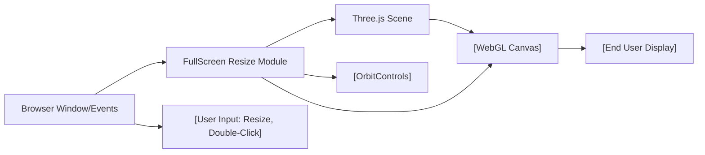

# FullScreen Resize Module

## Overview
The **FullScreen Resize** module enhances Three.js-based web applications by providing fully responsive canvas rendering and fullscreen toggling capabilities. It ensures the 3D canvas automatically fits any browser window size changes and allows users to enter or exit fullscreen mode—greatly improving user experience for interactive 3D visualizations and games.

## Key Features
- **Responsive Canvas Sizing**: The canvas automatically adapts its dimensions and Three.js camera settings to browser window resizes, maintaining undistorted 3D rendering across devices.
- **Fullscreen Toggle Support**: Users can double-click the canvas to enter or exit fullscreen display, supporting both standard and Webkit browsers for broad compatibility.
- **Three.js Integration**: Seamlessly ties into Three.js rendering pipeline, keeping visuals, camera, and controls in sync during dynamic resizing or fullscreen changes.
- **Orbit Controls**: User-enabled scene navigation with smooth and intuitive 3D controls, updated responsively after size changes.
- **Device Pixel Ratio Management**: Ensures crisp rendering on high-DPI displays by updating the renderer's pixel ratio.

## System Errors
- **Camera/Renderer Not Updated on Resize**:  
  *Description*: If camera aspect ratio or renderer size isn’t updated after a window resize, 3D visuals may appear stretched or squashed.  
  *Resolution*: The module listens for `resize` events and refits the camera and renderer.
- **Fullscreen Not Triggered**:  
  *Description*: Double-clicking may not toggle fullscreen if browser permissions are restricted or if `requestFullscreen`/`webkitRequestFullscreen` are not supported.  
  *Resolution*: The module provides both standard and Webkit fullscreen API calls; ensure browser/device supports necessary APIs.
- **Controls Glitch After Resize**:  
  *Description*: 3D navigation may feel off if OrbitControls are not updated after canvas size change.  
  *Resolution*: Controls are updated every animation frame including after resizing, preserving smooth navigation.

## Usage Examples

```js
// Import Three.js and OrbitControls
import * as THREE from 'three'
import { OrbitControls } from 'three/examples/jsm/controls/OrbitControls.js'

// Select the canvas element
const canvas = document.querySelector('canvas.webgl')

// Initialize scene, camera, and renderer
const scene = new THREE.Scene()
const camera = new THREE.PerspectiveCamera(75, window.innerWidth/window.innerHeight, 0.1, 100)
camera.position.z = 3
scene.add(camera)

const renderer = new THREE.WebGLRenderer({ canvas })
renderer.setSize(window.innerWidth, window.innerHeight)

// Add OrbitControls for camera navigation
const controls = new OrbitControls(camera, canvas)
controls.enableDamping = true

// Responsive resize
window.addEventListener('resize', () => {
    camera.aspect = window.innerWidth / window.innerHeight
    camera.updateProjectionMatrix()
    renderer.setSize(window.innerWidth, window.innerHeight)
    renderer.setPixelRatio(Math.min(window.devicePixelRatio, 2))
})

// Fullscreen toggle on double-click
window.addEventListener('dblclick', () => {
    if (!document.fullscreenElement) {
        canvas.requestFullscreen ? canvas.requestFullscreen() : canvas.webkitRequestFullscreen()
    } else {
        document.exitFullscreen ? document.exitFullscreen() : document.webkitExitFullscreen()
    }
})

// Animation loop
function animate() {
    controls.update()
    renderer.render(scene, camera)
    requestAnimationFrame(animate)
}
animate()
```

## System Integration


