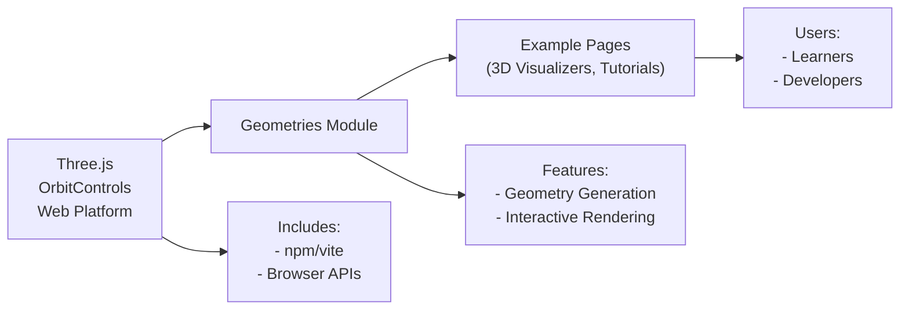

# Geometries Module

## Overview
The **Geometries** module provides a Three.js-based visualization environment for rendering and interacting with custom 3D geometries directly in the browser. Its main purpose is to enable users to explore and experiment with procedural and buffer geometries, offering interactive controls and real-time rendering on a web canvas. This module serves as a foundational component for learning and showcasing 3D geometry concepts within a modern JavaScript frontend.

## Key Features
- **Custom Procedural Geometry Rendering**: Generates and displays 3D buffer geometries with random vertex positions, allowing exploratory visualization of geometric constructs.
- **Three.js Scene Setup**: Establishes a basic scene with camera, renderer, and lighting, suitable as a starting point for 3D web applications.
- **Interactive Orbit Controls**: Integrates OrbitControls to enable real-time user interaction with the 3D scene (pan, zoom, rotate).
- **Responsive Canvas**: Automatically adjusts rendering parameters and camera on window resize for seamless user experience across devices.
- **Wireframe Material**: Utilizes wireframe rendering for clear visualization of geometry structure.

## System Errors
- **Black or Empty Canvas**: Occurs if the WebGL context cannot be created or if there are issues in Three.js initialization.
  - **Resolution**: Ensure the browser supports WebGL and all dependencies are installed (`npm install`). Check the canvas selector targeting `.webgl`.
- **Geometry Not Visible**: May happen if geometry generation fails or all vertices collapse to a single point.
  - **Resolution**: Check procedural geometry code to confirm randomization and assignment to position buffer. Refresh the page to re-generate geometry.
- **Resize Distortion**: Canvas appears stretched or squashed after resizing.
  - **Resolution**: The system updates camera aspect and renderer size on window resize. Ensure the resize event handler remains intact and that no custom CSS overrides canvas proportions.

## Usage Examples

```js
// Import Three.js and required controls
import * as THREE from 'three'
import { OrbitControls } from 'three/examples/jsm/controls/OrbitControls.js'

// Get the canvas element
const canvas = document.querySelector('canvas.webgl')

// Create a basic Three.js scene
const scene = new THREE.Scene()

// Define a procedural BufferGeometry
const geometry = new THREE.BufferGeometry()
const count = 50
const positionsArray = new Float32Array(count * 3 * 3)
for(let i = 0; i < count * 3 * 3; i++) {
    positionsArray[i] = Math.random() - 0.5
}
const positionsAttribute = new THREE.BufferAttribute(positionsArray, 3)
geometry.setAttribute('position', positionsAttribute)

// Create a mesh with wireframe material
const material = new THREE.MeshBasicMaterial({ color: 0xff0000, wireframe: true })
const mesh = new THREE.Mesh(geometry, material)
scene.add(mesh)

// Set up camera and renderer
const camera = new THREE.PerspectiveCamera(75, window.innerWidth / window.innerHeight, 0.1, 100)
camera.position.z = 3
scene.add(camera)

const renderer = new THREE.WebGLRenderer({ canvas })
renderer.setSize(window.innerWidth, window.innerHeight)

// Add interactive controls
const controls = new OrbitControls(camera, canvas)
controls.enableDamping = true

// Animation/render loop
function animate() {
    controls.update()
    renderer.render(scene, camera)
    requestAnimationFrame(animate)
}
animate()
```

## System Integration


