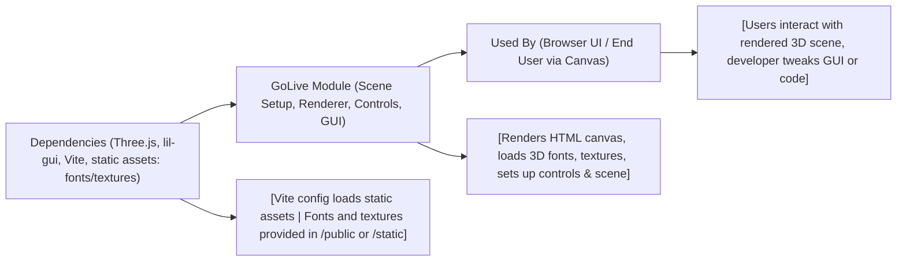

# GoLive Module

## Overview
The **GoLive** module provides an out-of-the-box, client-side 3D visualization playground powered by [Three.js](https://threejs.org/) and [Vite](https://vitejs.dev/) for local development and production builds. It renders interactive 3D scenes using customizable 3D text, materials, and ambient meshes ("donuts"), and is designed as a modern, zero-backend solution for rapid prototyping or demos. The module also supports an intuitive developer experience with instant reloads, configuration via Vite, and built-in GUI controls using lil-gui.

## Key Features
- **3D Scene Rendering**: Automatically sets up a Three.js scene with camera, controls (OrbitControls), lighting, renderer, and responsive resizing.
- **Customizable 3D Text**: Loads a JSON font and renders custom text in 3D, including bevel effects, center alignment, and material styling via matcap textures.
- **Geometry Generators ("Donuts")**: Generates multiple randomly positioned and sized torus meshes to demonstrate 3D geometry primitives and instancing.
- **Live GUI Controls**: Integrates lil-gui for real-time parameter tweaking, aiding both development and demonstration.
- **Responsive Viewport**: Ensures the renderer, camera, and scene adjust seamlessly to browser window size changes.
- **Rapid Local Development & Builds**: Utilizes Vite for instant hot-module reload in development and optimized static builds for production.
- **Static Asset Integration**: Loads external resources (textures, fonts) from static directories, allowing easy updates and replacements.

## System Errors
- **Font or Texture Load Failure**:  
  _Description_: Font or texture files might fail to load if paths are incorrect or resources are missing.  
  _Resolution_:  
    - Ensure `/fonts/helvetiker_regular.typeface.json` and referenced textures exist in the correct public/static folders.  
    - Check case sensitivity and network requests in browser developer tools.
- **Canvas Not Found**:  
  _Description_: The script expects `canvas.webgl` in your HTML. If not present, Three.js initialization fails.  
  _Resolution_:  
    - Make sure `<canvas class="webgl"></canvas>` is present in your HTML.
- **Vite Server Not Running or Wrong Port**:  
  _Description_: Attempting to open the application without starting the Vite development server causes a connection error.  
  _Resolution_:  
    - Run `npm install` and `npm run dev` from the `GoLive` directory.

## Usage Examples

```js
// Import/require not needed if using the default setup.
npm install
npm run dev    // Start local development server (http://localhost:8080)

//
// Main features in src/script.js
//

// To change the displayed text, edit this section:
const textGeometry = new TextGeometry(
    'Hello Three.js', // <-- Change text here
    { font, size: 0.5, height: 0.2, /* ... */ }
)

// To adjust donut count or properties:
for(let i = 0; i < 100; i++) { /* ... */ }

// To enable/disable OrbitControls damping in the GUI:
controls.enableDamping = true;
gui.add(controls, 'enableDamping');

// To build for static deployment:
npm run build     // Output is available in 'dist/' for static hosting
```

## System Integration


