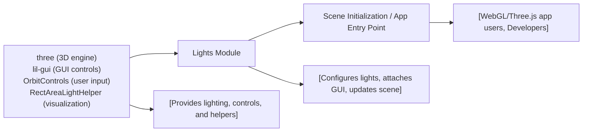

# Lights Module

## Overview
The Lights module demonstrates the integration and configuration of multiple types of lights within a Three.js scene. It provides interactive controls for adjusting lighting parameters, enabling real-time experimentation with different lighting effects. The module showcases how to visually enhance 3D objects using a variety of light sources and visual helpers, making it pivotal for rendering realistic and dynamic scenes in browser-based 3D applications.

## Key Features

- **Multiple Light Types**: Integrates Ambient, Directional, Hemisphere, Point, RectArea, and Spot lights, each adding unique effects to the scene and supporting different lighting scenarios.
- **Interactive Lighting Control**: Uses a GUI to allow live, real-time adjustments of light intensities, empowering users to fine-tune scene illumination.
- **Visual Light Helpers**: Visualizes light sources and their reach/impact using helper objects, aiding debugging and precise light placement.
- **Seamless Object Illumination**: Demonstrates how multiple lights collectively affect 3D object appearance by illuminating basic geometries like spheres, cubes, and planes.
- **Responsive Rendering**: Supports window resizing, ensuring that lighting and rendering adapt to various display sizes without visual artifacts.
- **Orbit Controls Integration**: Enables interactive scene exploration, so users can view lighting effects from any angle.

## System Errors

- **Canvas Not Found**: If the `.webgl` canvas is missing from the HTML, the 3D scene and lights will not render.  
  _Resolution_: Ensure `<canvas class="webgl"></canvas>` is present in your HTML body.

- **Missing Light Helpers**: If a light helper is not added for a specific light type, its effect or orientation may be hard to debug visually.  
  _Resolution_: Confirm all relevant helpers are added to the scene after their associated lights.

- **Resize Handling Failure**: If the window `resize` event isn't functioning, the renderer or camera may display the scene incorrectly on window size changes.  
  _Resolution_: Make sure event listeners are set and the camera & renderer are updated on each resize event.

## Usage Examples

```js
import * as THREE from 'three'
import { OrbitControls } from 'three/examples/jsm/controls/OrbitControls.js'
import GUI from 'lil-gui'

// Select the canvas and create a scene
const canvas = document.querySelector('canvas.webgl')
const scene = new THREE.Scene()

// Add lights to the scene
const ambientLight = new THREE.AmbientLight(0xffffff, 1)
scene.add(ambientLight)

// Use GUI to adjust light properties
const gui = new GUI()
gui.add(ambientLight, 'intensity').min(0).max(1).step(0.001)

// Add a mesh to observe lighting
const material = new THREE.MeshStandardMaterial({ roughness: 0.4 })
const sphere = new THREE.Mesh(new THREE.SphereGeometry(0.5, 32, 32), material)
scene.add(sphere)

// Set up camera, controls, and renderer
const camera = new THREE.PerspectiveCamera(75, window.innerWidth / window.innerHeight, 0.1, 100)
camera.position.set(1, 1, 2)
scene.add(camera)

const controls = new OrbitControls(camera, canvas)
controls.enableDamping = true

const renderer = new THREE.WebGLRenderer({ canvas })
renderer.setSize(window.innerWidth, window.innerHeight)
renderer.setPixelRatio(Math.min(window.devicePixelRatio, 2))

// Animation loop
function animate() {
  sphere.rotation.y += 0.01
  controls.update()
  renderer.render(scene, camera)
  requestAnimationFrame(animate)
}
animate()
```

## System Integration


