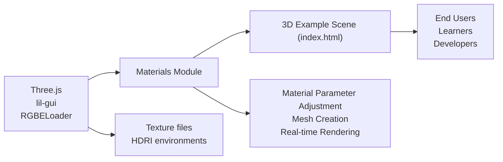

# Materials Module

## Overview
The Materials module is a Three.js example application that demonstrates a variety of 3D material and texture features. It enables users to interactively explore different material types and properties using a graphical user interface. This module is focused on visualizing material effects—such as metalness, roughness, transparency, and environmental reflections—on 3D geometries, providing a basis for learning and experimentation with physically-based rendering in Three.js.

## Key Features

- **Interactive Material Controls**: Users can dynamically adjust various material parameters (metalness, roughness, transmission, etc.) in real time through an integrated GUI (lil-gui).
- **Multi-Texture Support**: Demonstrates loading and applying multiple texture maps (color, alpha, ambient occlusion, normal, height/displacement, metalness, roughness) to materials.
- **Physically-Based Rendering (PBR)**: Utilizes `MeshPhysicalMaterial` to showcase realistic surface properties including clearcoat, sheen, iridescence, transmission, and IOR.
- **Environment Mapping**: Integrates HDR environment maps to add physically-accurate reflection and lighting effects.
- **Multiple 3D Geometries**: Applies materials uniformly across various shapes (sphere, plane, torus) to visualize properties on different surfaces.
- **Responsive Rendering**: Adapts canvas size and camera to window resizing, ensuring the 3D scene maintains correct proportions.
- **User Camera Controls**: Supports interactive orbit controls, allowing users to rotate and pan around the scene smoothly.

## System Errors

- **Texture Loading Failure**: If a texture file is missing or the path is incorrect, Three.js will log a load error and the affected material property may render incorrectly (e.g., missing color or surface detail).
  - **Resolution**: Ensure all referenced textures exist in the `textures` directory and paths in code match the asset locations.
- **GUI Parameter Issues**: If properties are removed or renamed in the material but still referenced in GUI controls, the GUI may stop responding to parameter changes or produce warnings.
  - **Resolution**: Keep GUI parameter bindings in sync with the material properties being used.
- **HDR Environment Map Load Failure**: An invalid or missing HDR file for the environment map may result in a black background or incorrect lighting/reflection.
  - **Resolution**: Verify the HDR file path and format are correct. Ensure compatible Three.js/RGBELoader versions.

## Usage Examples

```js
import * as THREE from 'three'
import GUI from 'lil-gui'

// 1. Prepare the scene and camera
const scene = new THREE.Scene()
const camera = new THREE.PerspectiveCamera(75, window.innerWidth/window.innerHeight, 0.1, 100)
camera.position.set(1, 1, 2)
scene.add(camera)

// 2. Load textures for material properties
const textureLoader = new THREE.TextureLoader()
const doorColorTexture = textureLoader.load('./textures/door/color.jpg')
// ... (other textures loaded similarly)

// 3. Create a MeshPhysicalMaterial with textures
const material = new THREE.MeshPhysicalMaterial({
  map: doorColorTexture,
  // set other texture maps as needed
  metalness: 0.7,
  roughness: 0.2,
  transmission: 1,
  ior: 1.5,
  thickness: 0.5,
  transparent: true,
  alphaMap: textureLoader.load('./textures/door/alpha.jpg')
})

// 4. Add real-time parameter controls via GUI
const gui = new GUI()
gui.add(material, 'metalness').min(0).max(1)
gui.add(material, 'roughness').min(0).max(1)
gui.add(material, 'transmission').min(0).max(1)

// 5. Create meshes and add to scene
const sphere = new THREE.Mesh(new THREE.SphereGeometry(0.5, 64, 64), material)
const plane = new THREE.Mesh(new THREE.PlaneGeometry(1, 1, 100, 100), material)
scene.add(sphere, plane)

// 6. Setup the renderer
const renderer = new THREE.WebGLRenderer({ canvas: document.querySelector('canvas.webgl') })
renderer.setSize(window.innerWidth, window.innerHeight)

// 7. Animate and render the scene
function animate() {
  sphere.rotation.y += 0.01
  renderer.render(scene, camera)
  requestAnimationFrame(animate)
}
animate()
```

## System Integration


