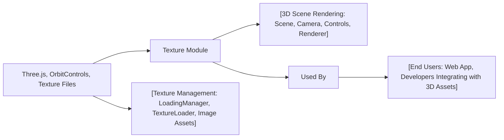

# Texture Module

## Overview
The Texture module demonstrates how to load, configure, and display textures on 3D objects using [Three.js](https://threejs.org/) with a focus on real-time WebGL rendering. It showcases how different types of textures (color, alpha, height, normal, ambient occlusion, metalness, and roughness) are managed, loaded, and applied to 3D geometry, allowing for richer and more interactive visual experiences. The module includes user controls for interacting with the 3D scene, making it suitable as a starting point for projects utilizing textured 3D assets.

## Key Features

- **Texture Loading with Progress Management**:  
  Uses Three.js's `LoadingManager` and `TextureLoader` to efficiently load various texture assets, with built-in callbacks for tracking load status and handling errors.

- **Multiple Texture Maps Support**:  
  Demonstrates loading and management of multiple texture types including color, alpha, height, normal, ambient occlusion, metalness, and roughness maps to enrich mesh surface detail.

- **Texture Configuration**:  
  Illustrates public settings for texture optimization including filtering (`magFilter`), mipmap control, and color space that directly impact rendering quality and performance.

- **Interactive 3D Controls**:  
  Integrates `OrbitControls` for intuitive camera manipulation, enabling users to interactively explore textured objects in real time.

- **Responsive Rendering**:  
  Automatically adapts the renderer and camera to window resizing, ensuring ongoing usability across devices and screen sizes.

## System Errors

- **Texture Load Error**:  
  If a texture fails to load, the `LoadingManager.onError` callback is triggered.
  - **Resolution**: Ensure the texture file path is correct and the file is accessible from the server. Check browser console for error logs referencing missing files.

- **Missing Texture File**:  
  If a specified texture (such as `/textures/door/alpha.jpg`) cannot be found, a 404 may occur, and the texture will render as missing.
  - **Resolution**: Verify texture files are present in the specified public or static directory and that URL paths are accurate relative to the root.

- **WebGL Context Issues**:  
  If the browser or device does not support WebGL, rendering may fail entirely.
  - **Resolution**: Confirm WebGL support in the browser. Use tools like [webglreport.com](https://webglreport.com/) for diagnostics.

## Usage Examples

```js
// Import dependencies
import * as THREE from 'three'
import { OrbitControls } from 'three/examples/jsm/controls/OrbitControls.js'

// 1. Set up Loading Manager and Texture Loader
const loadingManager = new THREE.LoadingManager()
const textureLoader = new THREE.TextureLoader(loadingManager)
const colorTexture = textureLoader.load('/textures/minecraft.png')

// 2. Optional texture settings for a pixelated effect
colorTexture.generateMipmaps = false
colorTexture.magFilter = THREE.NearestFilter
colorTexture.colorSpace = THREE.SRGBColorSpace

// 3. Build scene components
const canvas = document.querySelector('canvas.webgl')
const scene = new THREE.Scene()
const geometry = new THREE.BoxGeometry(1, 1, 1)
const material = new THREE.MeshBasicMaterial({ map: colorTexture })
const mesh = new THREE.Mesh(geometry, material)
scene.add(mesh)

// 4. Set up camera and controls
const camera = new THREE.PerspectiveCamera(75, window.innerWidth/window.innerHeight, 0.1, 100)
camera.position.set(1, 1, 1)
scene.add(camera)
const controls = new OrbitControls(camera, canvas)
controls.enableDamping = true

// 5. Configure renderer and animate
const renderer = new THREE.WebGLRenderer({ canvas })
renderer.setSize(window.innerWidth, window.innerHeight)

function animate () {
    controls.update()
    renderer.render(scene, camera)
    requestAnimationFrame(animate)
}
animate()
```

## System Integration


