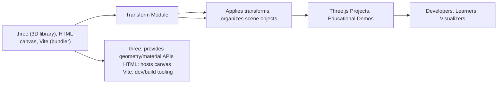

# Transform Module

## Overview
The **Transform** module establishes the foundation for object transformations within a basic Three.js scene. It highlights how to create, group, and manipulate 3D objects (meshes) using transformations like translation, rotation, and scaling. This module is essential for users who want to understand and experiment with positioning and organizing objects in a virtual 3D space using Three.js. It also introduces key rendering concepts, such as scene composition and camera setup.

## Key Features
- **3D Object Transformations**: Demonstrates how to translate, rotate, and scale objects individually and in groups within a scene.
- **Object Grouping**: Shows how to utilize Three.js `Group` to collectively transform multiple objects, simplifying hierarchical spatial organization.
- **Basic Scene Composition**: Provides convenient setup for a Three.js scene, including camera positioning, axes helper for orientation, and a canvas for WebGL output.
- **Renderer Integration**: Connects the transformation logic with Three.js's `WebGLRenderer` to visualize object transformations in real-time.
- **Axes Visualization**: Adds an `AxesHelper` to help users orient and better understand object positioning in the 3D space.

## System Errors
- **Canvas Not Found**:  
  *Description*: If the HTML page does not include a `<canvas class="webgl"></canvas>`, the module will not find the target for rendering, resulting in a runtime error.  
  *Resolution*: Ensure that your HTML file contains the correct canvas element with the `webgl` class.

- **Transformation Artifacts**:  
  *Description*: Inappropriate combinations of scaling, rotation, or translation can cause objects to appear distorted or outside the field of view.  
  *Resolution*: Adjust transformation properties carefully and use the `AxesHelper` to visually debug the scene’s orientation and scaling.

## Usage Examples

```javascript
// Create a group and apply transformations
const group = new THREE.Group();
group.scale.y = 2;       // Scale all children in Y by factor of 2
group.rotation.y = 0.2;  // Rotate all children around Y-axis

scene.add(group);

// Create and position cubes in the group
const cube1 = new THREE.Mesh(
    new THREE.BoxGeometry(1, 1, 1),
    new THREE.MeshBasicMaterial({ color: 0xff0000 })
);
cube1.position.x = -1.5;
group.add(cube1);

const cube2 = new THREE.Mesh(
    new THREE.BoxGeometry(1, 1, 1),
    new THREE.MeshBasicMaterial({ color: 0x00ff00 })
);
cube2.position.x = 0;
group.add(cube2);

const cube3 = new THREE.Mesh(
    new THREE.BoxGeometry(1, 1, 1),
    new THREE.MeshBasicMaterial({ color: 0x0000ff })
);
cube3.position.x = 1.5;
group.add(cube3);

// Add camera and render the scene
const camera = new THREE.PerspectiveCamera(75, 800/600);
camera.position.z = 3;
scene.add(camera);

const renderer = new THREE.WebGLRenderer({ canvas: document.querySelector('canvas.webgl') });
renderer.setSize(800, 600);
renderer.render(scene, camera);
```

## System Integration


