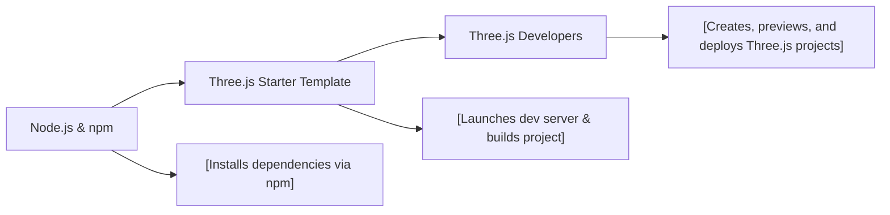

# Three.js Starter FAQ

## Overview
This module provides a streamlined starter template for Three.js projects, including local development, dependency management, and production builds. It simplifies the process of bootstrapping Three.js applications by standardizing how developers set up, run, and build their projects.

## Key Features
- **Dependency Installation**: Handles all project dependencies using Node.js and npm, ensuring consistency across environments.
- **Development Server**: Launches a local server for rapid development and live preview at `localhost:8080`.
- **Production Build**: Compiles project assets and outputs an optimized build in the `/dist` directory for deployment.

## System Errors
- **Missing Node.js/NPM**: Node.js or npm is not installed.  
  *Resolution*: Download and install the latest version from [nodejs.org](https://nodejs.org/en/download/).
- **Port 8080 Unavailable**: The development server fails to start because port 8080 is in use.  
  *Resolution*: Shut down processes using the port or configure another port.
- **Dependency Installation Failure**: `npm install` fails due to missing permissions or network issues.  
  *Resolution*: Check your internet connection and permissions. Run as administrator if necessary.

## Usage Examples

```bash
# 1. Install dependencies (only required once when first setting up the project)
npm install

# 2. Start the local development server (default: http://localhost:8080)
npm run dev

# 3. Build the project for production; output goes into the 'dist' folder
npm run build
```

## System Integration


