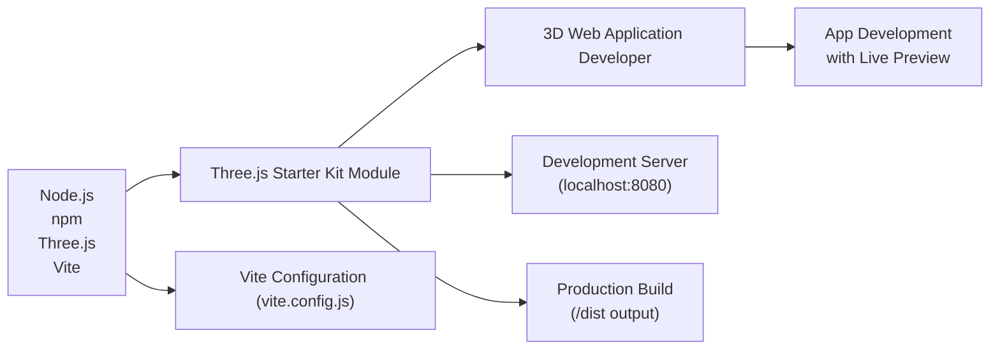

# Three.js Starter Kit

## Overview
The Three.js Starter Kit module provides a ready-to-run development environment for building 3D web applications using the Three.js library. It streamlines project setup by including essential tooling, a development server, and production build integration. This module is intended as an entry point for developers beginning with Three.js, ensuring consistent build output and fast local development cycles.

## Key Features
- **Development Server**: Instantly spin up a local server with live reload at `localhost:8080` to preview and iterate on your Three.js projects.
- **Production Build Integration**: Generate optimized, production-ready assets in a `/dist` folder, suitable for deployment.
- **Three.js Ready Environment**: Three.js is pre-installed and configured via npm, simplifying 3D application development.
- **Vite-powered Tooling**: Utilizes Vite for fast builds, efficient hot module replacement, and smooth configuration via `vite.config.js`.

## System Errors
- **Port Unavailable**: If `localhost:8080` is in use, the development server may fail to start.  
  *Resolution*: Stop conflicting processes or specify a different port in the Vite config.
- **Missing Dependencies**: Running the dev server without `npm install` may cause module not found errors.  
  *Resolution*: Always run `npm install` before `npm run dev`.
- **Build Directory Permissions**: Errors may occur if the `/dist` directory is write-protected.  
  *Resolution*: Check permissions on the `dist` folder or try running the build with elevated permissions.

## Usage Examples
Practical code examples showing how to use the module:

```bash
# 1. Install dependencies (run once after cloning)
npm install

# 2. Start the development server (auto-opens browser)
npm run dev
# Access your app at http://localhost:8080

# 3. Build the project for production
npm run build
# The compiled files will be in the dist/ directory
```

## System Integration


